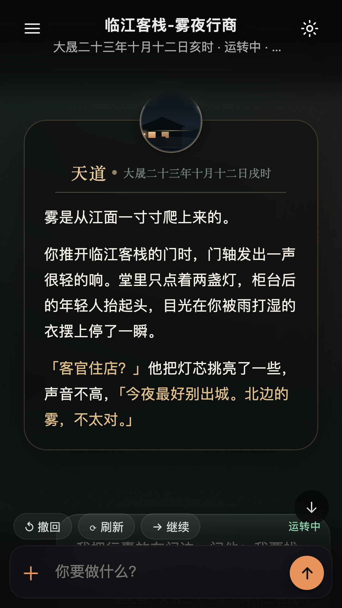
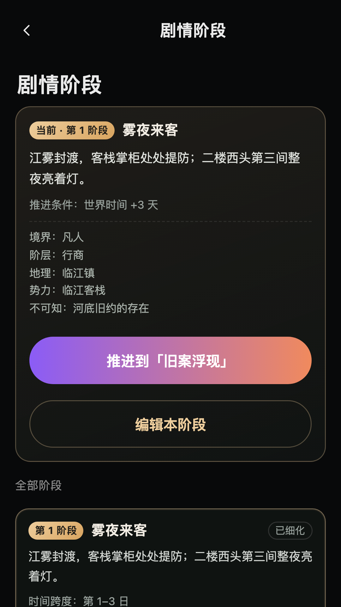
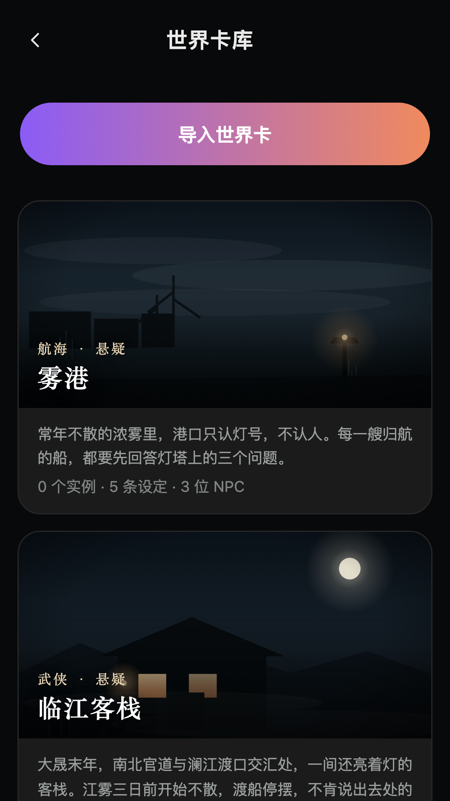
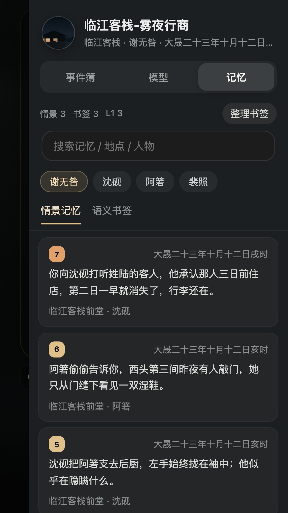
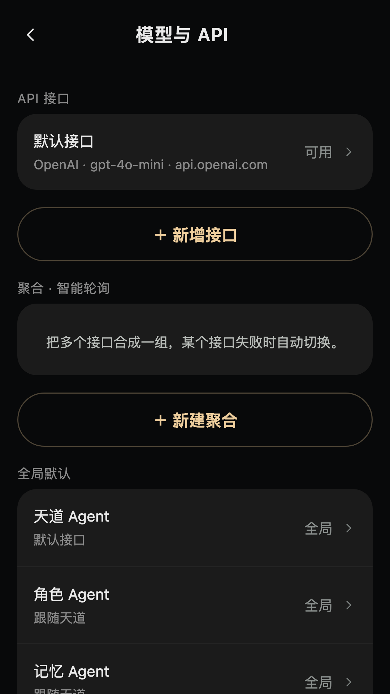

# 启源 · Qiyuan

**沉浸式虚拟世界体验 · 单机 AI 互动叙事**

启源是一款不依赖服务器、不注册账号、没有世界市场的 Android 互动叙事应用。世界卡、角色、对话、记忆与时间线都保存在本机；你只需要配置自己的大模型接口。

> **English**: Qiyuan is a local-first Android interactive fiction app. Bring your own OpenAI-compatible or Anthropic endpoint; no account, no developer server, no telemetry.

## 功能

- **世界卡库**：导入、导出、复用世界卡；同一张卡可创建多个实例。
- **自由 / 剧情双模式**：剧情阶段只属于实例，运行时只注入当前阶段与已揭示事实。
- **NPC 独立记忆**：档案、目标、情绪、健康、关系与演化历史；演化只写实例，不回写世界卡。
- **四层记忆**：L1 工作记忆、L2 情景记忆、L3 语义书签、L4 角色档案。
- **时间线**：开始 / 暂停 / 跳转、离线时间填补与世界事件簿。
- **自带模型**：OpenAI 兼容、Anthropic、聚合组智能轮询；天道 / 角色 / 记忆可分别选择。
- **本机数据**：无账号、无云端同步；API Key 经 Android Keystore 加密。
- **三套主题**：纸月 / 晨雾 / 视觉小说，支持自定义 CSS。

## 截图

| 叙事 | 剧情阶段 | 世界卡库 |
|---|---|---|
|  |  |  |

| 记忆 | 模型与 API |
|---|---|
|  |  |

## 下载

- GitHub Releases：<https://github.com/OWNER/qiyuan/releases>
- F-Droid：提交审核中；通过后可通过 F-Droid 客户端安装。

APK 使用项目自签名证书；F-Droid 版本使用 F-Droid 自己的签名，两者不能互相覆盖安装。

## 构建

要求：JDK 17、Android SDK 35。

```bash
export ANDROID_HOME=/path/to/android-sdk
./gradlew assembleRelease
```

没有 `tavo-release.keystore` 时生成未签名 release APK：

```bash
./gradlew assembleRelease
# app/build/outputs/apk/release/app-release-unsigned.apk
```

本地签名（不要提交 keystore）：

```bash
export TAVO_STORE_PASSWORD=...
export TAVO_KEY_ALIAS=tavo
export TAVO_KEY_PASSWORD=...
./gradlew assembleRelease
```

### 前端资源

前端是纯静态文件，`www/app.js` 由 `.build/p0..p6.js` 拼接：

```bash
cd www
cat .build/p0.js .build/p1.js .build/p2.js .build/p3.js \
    .build/p4.js .build/p5.js .build/p6.js > app.js
```

修改 `www` 后同步到 `app/src/main/assets/www`：

```bash
cd ..
rm -rf app/src/main/assets/www && cp -R www app/src/main/assets/
rm -f app/src/main/assets/www/preview.html app/src/main/assets/www/seed.html
rm -rf app/src/main/assets/www/.build
```

## 隐私与 AI 声明

- 启源不收集个人身份信息，不包含广告、统计或推送 SDK。
- 网络请求仅在你主动使用 AI 生成时发往你配置的第三方接口。
- 应用内叙事由 AI 生成，内容为虚构，仅供娱乐。
- 完整隐私政策见 [PRIVACY.md](PRIVACY.md) / [docs/privacy.html](docs/privacy.html)。

## 架构

- Android WebView 壳 + 纯静态前端，无前端框架、无构建步骤。
- 原生 HTTP 桥实现 SSE 流式输出与不受 CORS 限制的模型请求。
- 数据：`localStorage` 结构化存档 + `IndexedDB` 图片。
- 包名：`app.tavo.rp`；最低 Android 8.0（API 26）。

## 许可证

[MIT](LICENSE) © 2026 Tavo

应用内叙事由用户配置的第三方模型生成；第三方模型、接口与生成内容受各自服务条款约束。
